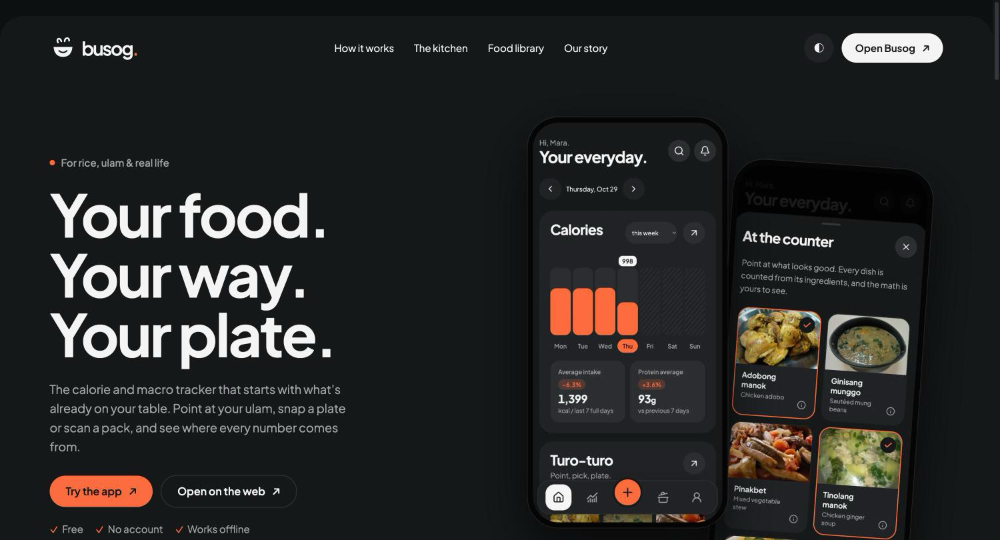
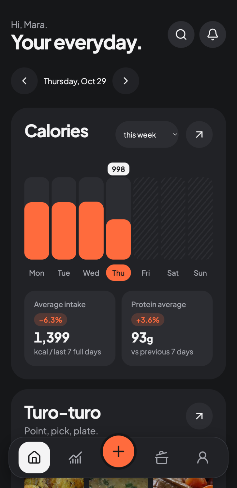
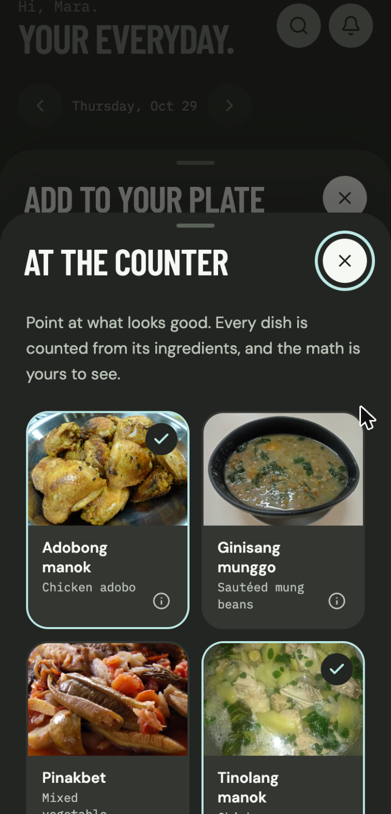
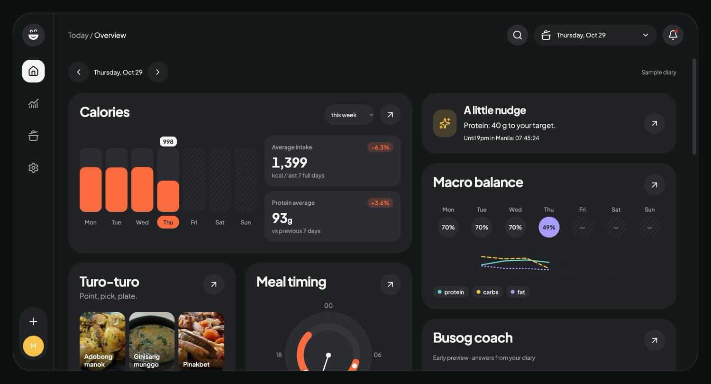

# Busog

Busog is a calorie and macro tracker with wide range of dishes across the globe. Use it on a phone or website to log
meals, review portions and follow your daily totals.

[Open Busog](https://vanomarb.github.io/busog/)

 
 

## What you can do

- Build a plate at the dish counter: pick dishes and portions, and see how each ingredient adds up.
- Try Snap with a sample plate photo, review its USDA ingredients and adjust the grams before logging.
- Search USDA foods with an offline fallback. Look up packaged-food barcodes through Open Food Facts. Camera scanning
  works in supported browsers; you can also type the digits.
- Review meal totals, calories, macros, water, weight history and progress charts in one diary. Entries keep their gram
  weights and visible source marks.
- Choose a region. International shows English names and a counter of international dishes; Philippines shows Filipino
  names first and a turo-turo counter of Filipino dishes. Search understands both names either way.
- Browse original recipes, food references, help and articles. Adjust serving sizes and calorie targets.
- Save changes in your browser and export your diary as JSON.

## Where the data comes from

The bundled snapshot contains 110 foods from USDA FoodData Central SR Legacy (April 2018), under public domain / CC0.
Records keep their FDC IDs, food states, serving weights and per-100g calories, protein, carbohydrate and fat. No
nutrition values are invented or supplied by AI. Live USDA search falls back to the bundled foods. It uses a public API
key; an optional personal data.gov key stays in your browser and is excluded from exports.

Open Food Facts supplies live barcode records under ODbL / DbCL. Its attribution stays separate from the CC0 snapshot.
Missing or incomplete records receive no guessed values.

The 25 original recipes, from spaghetti bolognese and black bean tacos to salmon rice bowls and chicken adobo, use
weighed ingredients, with totals calculated from the food data. Cooking states and serving assumptions are shown. Each
recipe has a Wikimedia Commons photo of that dish under CC0, CC BY or CC BY-SA, credited on the site's Credits page. The
site also includes eight original articles.

The starting diary, water, weight history and streak are sample data generated consistently from the current Asia/Manila
date. Starting fresh restores a sample diary for your selected region. Snap uses staged sample plates and simulated
recognition. Nothing is uploaded. Busog Coach is an early preview with scripted replies based on your diary.

Edits stay in localStorage, or in memory if browser storage is blocked. There are no accounts, payments, analytics or
live lead-capture forms. Contact forms validate locally and send nothing.

Full sources, image licences, font notices and the visual reference by tubik are in [REFERENCES.md](REFERENCES.md) and
on the site's [Credits page](https://vanomarb.github.io/busog/credits/). Full font and icon notices are in
[public/licenses/](public/licenses/).

## Disclaimer

The target calculator is an adult educational example using the Mifflin–St Jeor equation. It is not individual medical
advice.

Running it locally or contributing? See [DEVELOPMENT.md](DEVELOPMENT.md).
